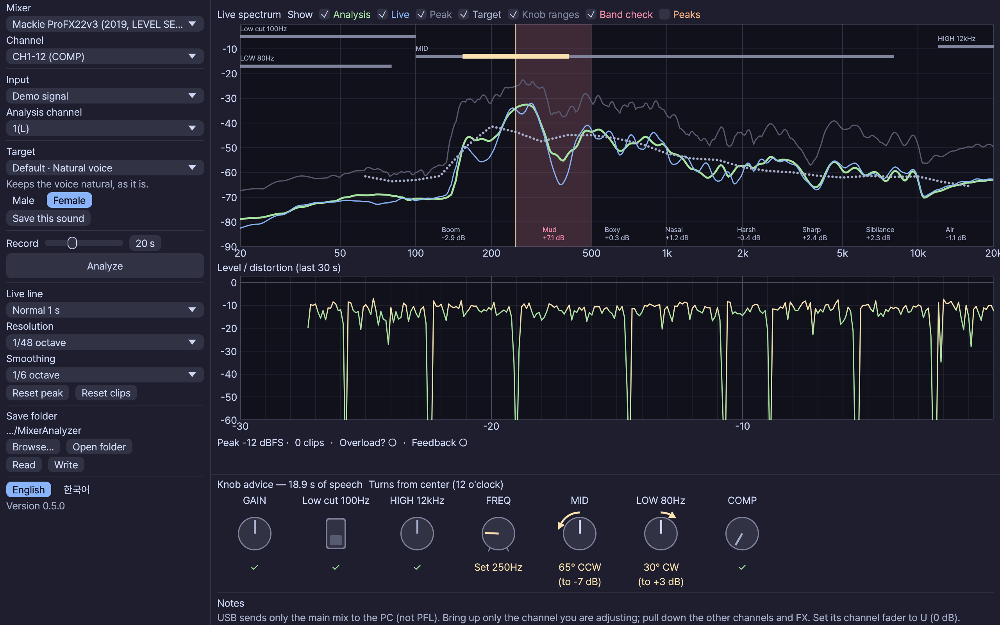
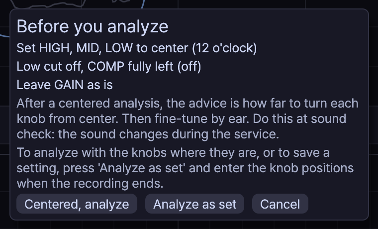
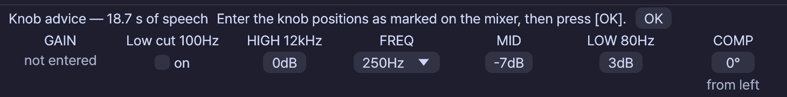
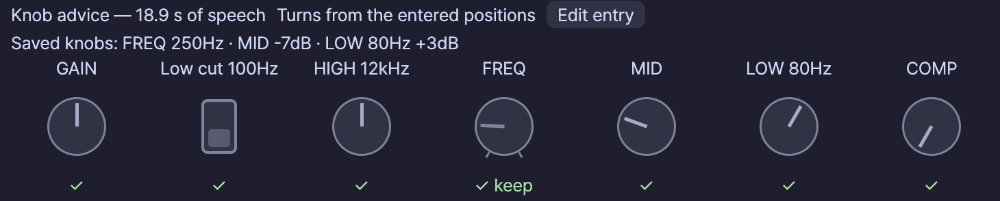

# Mixer Analyzer

Listens to a voice through an analog mixer and tells you which EQ knob on that channel to turn, which way, and how far. Built for church sound checks: set the EQ to 12 o'clock, press **Analyze**, and talk for 20 seconds. You fine-tune by ear after that.

<p align="center">
  
</p>

## Installation

- **macOS:** Apple menu → **About This Mac** shows the chip. Take `MixerAnalyzer-mac-AppleSilicon.zip` for "Apple M…" or `MixerAnalyzer-mac-Intel.zip` for "Intel", unzip it, and move `MixerAnalyzer.app` to Applications.
- **Windows:** run `MixerAnalyzer-Setup.exe`, then start **Mixer Analyzer** from the Start menu or the desktop. Uninstall in Settings → Apps; saved settings stay. If you used the old zip version, delete the old `MixerAnalyzer.exe` and its shortcut: it never checks for updates.

### First launch

- **macOS:** the first launch is blocked ("can't be opened"). Open **System Settings → Privacy & Security** and click **Open Anyway**. Allow the microphone when asked; denied, the app gets silence and warns that there is no input.
- **Windows:** if "Windows protected your PC" appears, click **More info → Run anyway**. If no sound comes in, turn on microphone access in Settings → Privacy & security → Microphone.

### Updates

At launch the app checks for a new version and shows **New version available** at the top of the left panel. Nothing shows when offline.
- Windows: **Update** downloads the installer, opens it and closes the app. Not during a service.
- macOS: **Download** opens the download folder; replace the app with the new zip.

The running version is at the bottom of the left panel.

### Language

The app starts in English. **English** / **한국어** at the bottom of the left panel switches it, and the choice is remembered. Saved settings work in either language.

## Connecting the mixer

The app hears whatever reaches the computer. Send it the one channel you are setting up. The tip for the picked mixer also shows at the bottom of the window.

| Mixer | Connection |
|---|---|
| Mackie ProFX | USB carries the main mix only (not PFL). Raise only that channel, pull the other channels and FX down, channel fader at U (0 dB). |
| Mackie 1202/1402/1604VLZ4, Yamaha MG06X, Soundcraft EPM | No USB. SOLO/PFL the channel and send CONTROL ROOM (or PHONES) to the computer through an audio interface. |
| Yamaha MGP X | No USB audio to the computer. PFL the channel, send MONITOR OUT L to an audio interface, and leave the MONITOR knob in one place. |
| Yamaha MG XU | USB carries the STEREO bus, after the fader. Send only that channel to ST, the others off, fader at 0 dB. |
| Behringer | USB carries the main mix. Raise only that channel, other channels and FX down. |
| Soundcraft Signature | Set USB SEND to MST for the main mix. Raise only that channel. |
| Allen & Heath ZED | Release every USB source switch for the main L-R. Raise only that channel. ZED-6 and ZEDi-8 have no USB: use SOLO/PFL and an audio interface. |

## Usage

1. In the left panel pick the **Mixer**, **Channel** group, **Input** device, **Analysis channel** (1 = L, 2 = R), **Target** and **Male** / **Female** voice.
2. Press **Analyze**. A dialog lists the knobs this channel has:

   <p align="center">
     
   </p>

   Turn HIGH, MID and LOW to 12 o'clock, the low cut off and COMP fully left (off). Leave GAIN. Then press **Centered, analyze** or `Enter`. **Cancel** or `Esc` closes the dialog.
3. Talk as usual until the recording ends. The **Record** slider sets its length: 15–30 s, 20 s by default. Meanwhile the button turns into **Cancel**.
4. Turn each knob as the knob row says, then fine-tune by ear.

The analysis needs at least 5 s of speech; if there wasn't enough, the notes say so: press **Analyze** again and keep talking. Do it at the sound check: during the service the sound keeps changing.

The result stays until the next analysis, and the previous one stays visible while recording. Changing the mixer, channel group, target or voice recomputes the advice from it without recording again.

### Knob row

Each knob gets a dial and a caption. The needle is where the knob is, the yellow arc where to turn it.

| Caption | Meaning |
|---|---|
| `30° CW` / `65° CCW` | Turn 30° clockwise / 65° counter-clockwise |
| `(to +3 dB)` | That lands on the +3 dB mark |
| `Set 250Hz` | Set FREQ to the 250 Hz mark |
| `To 30° from left` | COMP: turn to 30° from the left end |
| `Turn on` | Turn the low cut on |
| `✓` / `✓ keep` | Leave it where it is |

- After a center analysis the turns are from 12 o'clock; after an as-set analysis, from the positions you entered (see [Analyzing as set](#analyzing-as-set)). GAIN is always from where it is now. The header says which.
- Angles are a feel, not a measurement.
- A knob never boosts inside a red band of the graph, or cuts inside a blue one.
- HIGH is never boosted past +6 dB, except when restoring a saved setting.

### Graph

| Line | Meaning |
|---|---|
| Green, thick | **Analysis**: averaged over the recording |
| Blue | **Live**: the sound now |
| Dark gray | **Peak**: it never falls; **Reset peak** or a new analysis clears it |
| Dotted | **Target**: shifted to sit on the analysis over most of 100 Hz–12.5 kHz. Compare shapes, not heights; overall level is GAIN's job |

Bring the green line to the dotted one. The checkboxes beside **Show** turn each layer on and off; their color is the line's color. **Peaks** starts off at every launch, the rest on.

- **Knob ranges**: bars along the top show the range each EQ knob covers. A sweepable MID covers its whole FREQ range; the advised FREQ gets a yellow line and bar.
- **Band check**: the analysis against the target in eight bands. A band 3 dB or more over the target is red, 3 dB or more under is blue, with its name and difference along the bottom. Read it against the target, not as good or bad: 2.4–3.6 kHz, for one, holds presence as well as harshness.

  | Boom | Mud | Boxy | Nasal | Harsh | Sharp | Sibilance | Air |
  |---|---|---|---|---|---|---|---|
  | 80–250 Hz | 250–500 Hz | 500–800 Hz | 800–1.5k | 1.5–3k | 3–5k | 5–10k | 10–20k |

- **Peaks**: up to 5 narrow peaks between 100 Hz and 10 kHz that stand 3 dB or more over their 1-octave surroundings, marked `▼ 892Hz +4dB`. The voice's own formants get marked too, so read them with the band check. Feedback has its own warning.

Graph settings in the left panel change only the drawing; they never need a new recording or change the advice:
- **Live line**: how fast the blue line follows, 0.3 / 1 / 3 s.
- **Resolution**: 1/12, 1/24, 1/48 or 1/96 octave; 1/48 by default.
- **Smoothing**: off, 1/24, 1/12, 1/6 or 1/3 octave; 1/6 by default. Stronger smoothing lowers narrow peaks. Smoothing narrower than two points of the resolution is widened.

Below the graph, **Level / distortion** shows the last 30 s of peaks, with clipping as red dots. The line under it shows the peak, the clip count (**Reset clips** zeroes it), suspected overload from the last analysis, and suspected feedback, live. The **Notes** at the bottom carry connection tips and noise and feedback warnings.

### Targets

The **Target** menu has groups:
- `Default · Natural voice`: the voice as it is, natural.
- `Worship leader`, `Preacher`, `Backing vocal`: known church vocal EQ settings. The line under the menu says when each one fits.

The advice starts from this voice through this mic: an already bright voice isn't told to add HIGH. **Male** / **Female** picks the base voice for the default and the presets. If the channel lacks a knob a preset needs, the notes say that part is left out.

## Analyzing as set

**Analyze as set** in the dialog records without touching the knobs. Use it when the knobs are already turned, or to save a setting. When the recording ends, the knob row turns into fields. Enter the knobs as the mixer's markings read, then press **OK**:

<p align="center">
  
</p>

| Knob | Enter |
|---|---|
| HIGH, MID, LOW | dB from center, −15 to 15 |
| FREQ | The mark. Required while MID isn't 0 |
| Low cut | **on** |
| COMP | Degrees from the left end, in 5° steps |
| GAIN | Not entered |

- The fields start where the knob row last pointed: the saved setting, the advised positions, or center. Fix only what differs.
- After **OK** the advice is turns from the entered positions. **Edit entry** in the header reopens the fields.
- Changing the mixer or channel group drops the entry and reopens the fields.
- With too little speech or a low sample rate there are no fields, just the knob names and the reason. The next as-set analysis starts from the same fill.

## Saving and restoring

A saved setting holds the sound (its spectrum) and the knob positions entered with it. The positions let you set the same mixer and channel straight away; the sound tells what's left to adjust today.

**Save** (someone who knows the sound):
1. Center the knobs, press **Analyze** → **Centered, analyze**. If you can read the knobs, an as-set analysis with the positions entered works too.
2. Turn as advised and refine by ear.
3. **Analyze** → **Analyze as set**. The fields start at the advised positions; fix what you changed by ear, then **OK**.
4. **Save this sound**, type a name, **Save**. Put speech or singing, and any accompaniment, in the name. The same name overwrites.

Saving is blocked between an as-set analysis and its **OK**. Saving right after a center analysis stores every knob at center.

**Restore** (a volunteer):
1. Pick `Saved · <name>` in **Target**.
2. On the same mixer and channel, the line `Saved knobs: …` under the knob row header lists every knob that isn't at center. Set them. This needs no analysis and no speaker, so it works before the service or after someone bumped a knob. Before the first analysis the knob row shows the same positions as turns from center; after one it shows that analysis, so go by the `Saved knobs` line.
3. While the same person talks: **Analyze** → **Analyze as set**, check the fields match the `Saved knobs` line, **OK**. Only what's left to adjust shows, as turns from there. All ✓ means done.

<p align="center">
  
</p>

- Each recording differs a little. Differences that size stay ✓: LOW 3–8 dB depending on the mixer and FREQ (about 10 dB on a Signature with MID at 160 Hz or lower), HIGH up to 3–5 dB. Adjust within that by ear.
- A LOW turn may come out larger than needed; check the lows by ear after turning.
- If one knob is flagged though nobody touched it (rare), analyze as set once more, with the fields fixed to where the knobs are, and turn only if it comes back the same way.
- Can't read the knobs, or a different mixer? A center analysis works too: turning as advised brings back the saved sound. The notes say when the mixer or channel differs.
- The low cut is never advised off, only `Turn on` when it is off.
- GAIN isn't restored; it depends on how loud the person is that day. Only clipping and a too-quiet signal are flagged.
- COMP is never advised down. If the loudness swings more than when saved, it says to turn it to 30° from the left end (✓ if it is already there or further).
- Settings saved by 0.4.0 or older have no positions; they restore by sound only.
- Take a photo of the channel strip when saving.

**Delete** shows while a saved setting is picked. It turns into **Really delete**; press again to delete. Changing the target cancels.

### Save folder

Settings live in `saved.tsv` in the save folder, set under **Save folder** in the left panel:
- **Browse…** picks a folder, remembered across launches. A folder with a `saved.tsv` is read; in an empty one the current list is copied in. The old folder's file stays.
- **Open folder** opens it in Finder or Explorer. **Read** reads the file again. **Write** overwrites it with the current list.
- Default: `~/Library/Application Support/MixerAnalyzer` on macOS (in Finder's **Go** menu, hold Option for **Library**), `%APPDATA%\MixerAnalyzer` on Windows.
- Errors show in red in the notes. A file that couldn't be read is never overwritten until you press **Write**.

When several computers share the folder, run the latest version on all of them. Settings saved by older, Korean-language versions are read and keep working.
- 0.5.0 and older can't match settings saved by newer versions to their mixer: no saved knobs, and a note that the mixer differs.
- 0.3.2 and 0.4.0 can't read lines with knob positions and refuse to save or delete. **Write** there drops those lines.
- 0.3.1 and older can't read sounds saved by newer versions. Saving, deleting or **Write** there erases them.

## Building

Rust 1.96 (pinned in `rust-toolchain.toml`).

```bash
cargo run --release              # run from source
cargo run --release -- --demo    # Demo signal: a synthetic voice instead of a microphone
cargo test
scripts/build-mac.sh             # dist/MixerAnalyzer-mac-{AppleSilicon,Intel}.zip
scripts/build-win.sh             # dist/MixerAnalyzer-Setup.exe and dist/latest.txt
```

`build-win.sh` cross-compiles from macOS: it needs `cargo-xwin`, Homebrew `llvm` and `makensis`. `latest.txt` is the update feed: the version on the first line, the installer's download link on the second.

## License notices

- Font Pretendard Regular: SIL Open Font License 1.1 (`Pretendard-LICENSE.txt` in the install folder or the zip).
- Colors Catppuccin Mocha: MIT License, Copyright (c) 2021 Catppuccin.
